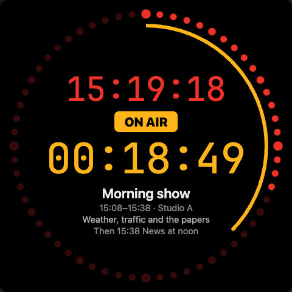
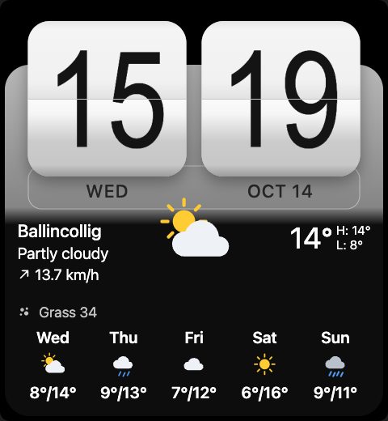

# Clock Cards

[](https://github.com/hacs/integration)
[](https://github.com/RadioErewan/clock-cards/releases)
[](LICENSE)

Two clocks for Home Assistant dashboards: a broadcast **studio clock** and a **flip clock** with
the weather.

<p>
  
  
</p>

Made for the idle page of [Wall Panel for HA](https://3210.lu/hapanel/), and good on any dashboard:
browser, the HA app, Fully Kiosk. The studio clock is the same one as in
[Studio Clock](https://3210.lu/studioclock/) for Android, macOS and iOS.

## Studio Clock (`custom:studio-clock-card`)

A ring of sixty dots lit up to the current second, the time in red, and a countdown to the next
event in your calendar. While an event is on air the countdown turns amber and runs to its end;
the arc inside the ring shows how far along it is. In the last seconds before a start the face
becomes a film leader: one large digit and a sweep round the ring each second.

- Reads any `calendar.*` entities (Google Calendar, CalDAV, Local Calendar, Microsoft 365 …).
  It sees what your HA user sees. All-day events are ignored: a studio clock counts timed ones.
- Overlapping events: the one that started last is shown, the others as "Also on air".
- Meeting invitations (Zoom, Teams, Meet) are cut out of the event notes.
- An optional `timer.*` entity takes over while it runs, and counts up for a minute when it ends.
- Picture shifts a few pixels every three minutes against AMOLED burn-in.

### Options

| Option | Default | |
|---|---|---|
| `entities` | | List of `calendar.*` entities |
| `timer` | | A `timer.*` entity, optional |
| `leader` | `5` | Seconds of film leader before a start, `0` for none |
| `layout` | `auto` | `auto`, `compact` (text inside the ring) or `wide` (text beside it, with a rundown) |
| `height` | | Any CSS length, such as `90vh`, for dashboards that do not stretch the card |
| `burn_in_shift` | `true` | Shift the picture now and then |
| `fullscreen_on_tap` | `false` | Tap the card to take it full screen, tap again to leave |

```yaml
type: custom:studio-clock-card
entities:
  - calendar.work
timer: timer.studio
layout: auto
```

## Flip Clock (`custom:flip-clock-card`)

Two flip cards with the hour and the minute, the weekday and date lettered on the base below,
and the weather from a Home Assistant `weather.*` entity: icon, temperature, high and low, wind
and a forecast. No animation, so nothing to wear out on a wall panel.

- Weather comes from the entity you pick, with the daily forecast through Home Assistant's own
  subscription. No API key, no location, no extra service.
- The layout follows the card's size: a small square shows the clock and the temperature, a wide
  strip adds the place and the description, a tall or large one adds wind, pollen and the week.
- Pollen: any sensors you choose; those at zero are left out.
- Four themes (classic, charcoal, amber, slate) and four digit faces.

| Option | Default | |
|---|---|---|
| `entity` | | A `weather.*` entity |
| `name` | entity's name | Place name shown |
| `theme` | `classic` | `classic`, `charcoal`, `amber`, `slate` |
| `typeface` | `condensed` | `condensed`, `rounded`, `serif`, `monospaced` |
| `time_format` | `auto` | `auto` (as in HA), `24`, `12` |
| `forecast_days` | `5` | 0 to 7; 0 for none |
| `pollen` | | List of sensor entities |
| `height` | | Any CSS length, such as `90vh` |
| `burn_in_shift` | `true` | Shift the picture now and then |
| `fullscreen_on_tap` | `false` | Tap the card to take it full screen, tap again to leave |

```yaml
type: custom:flip-clock-card
entity: weather.forecast_home
name: Ballincollig
theme: classic
pollen:
  - sensor.pollen_grass
```

## Full screen

Two different things go by that name.

**The card full screen in the browser**: set `fullscreen_on_tap: true` and a tap on the card takes
it to the browser's full screen; another tap or Esc leaves it. It needs a tap because browsers do
not allow full screen otherwise, and iPhones do not offer it for page elements at all.

**Without Home Assistant's sidebar and header**: the card cannot remove them, they belong to the
frame around the dashboard. Install [Kiosk Mode](https://github.com/NemesisRE/kiosk-mode) from
HACS (Frontend), then open the view with `?kiosk` added to its address:

```
https://homeassistant.local:8123/dashboard-xxx/zegar?kiosk
```

Use the address of your own dashboard and view. Only the clock is left on the screen. To hide just
one of the two, use `?hide_sidebar` or `?hide_header`. Add the address as the start page of a
wall tablet, or as a bookmark, and it opens that way every time. Both cards in a `panel` view fill
the whole space this leaves.

Wall Panel for HA and Fully Kiosk show the dashboard without the frame already, so the address
needs nothing added there.

## Install

### HACS

1. HACS → ⋮ → **Custom repositories**.
2. Add `https://github.com/RadioErewan/clock-cards`, category **Dashboard**.
3. Install **Clock Cards**, then reload the browser. Both cards appear in the card picker.

### By hand

Copy `dist/clock-cards.js` to `config/www/`, then add a dashboard resource
`/local/clock-cards.js?v=1` of type *JavaScript module*. Change the number in `?v=` after each
update, so browsers load the new file.

## Licence

MIT
